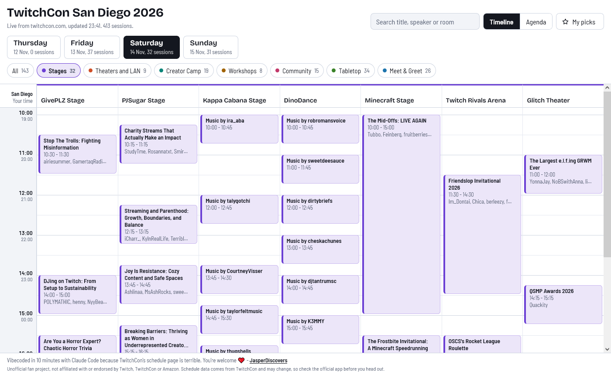
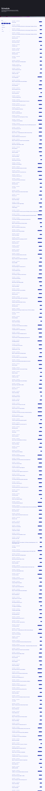

# tc.jasper.stream

**The TwitchCon San Diego 2026 schedule, but as a timeline you can actually read.**

👉 **[tc.jasper.stream](https://tc.jasper.stream)**



## Why this exists

TwitchCon publishes its schedule on twitchcon.com as **one list**. Not a grid, not a timeline, not "here's what's on at 2 PM". It's a list of 413 sessions (Thursday's partner thing, three full con days, every stage, every workshop, every Meet & Greet slot, every round of Pokémon Bingo) stacked on top of each other like a CVS receipt that achieved sentience.

Some numbers:

- The page is **58,575 pixels tall** on a 1080p screen. At 96 dpi that is about **15½ metres of scrolling**. You could lay it out next to a bowling lane and still have page left.
- Firefox's full-page screenshot stops at **32,766 pixels**. So when I tried to take a screenshot of the schedule, Firefox looked at it, said "no", and gave me *half*. The page is literally too tall to screenshot.
- Want to know what's on at the same time as the panel you're interested in? Scroll. Compare. Scroll back. Forget. Scroll again.

Here is that half of a screenshot, scaled down to 25% so GitHub doesn't file a complaint:

<details>
<summary><b>Behold: the official schedule (scaled down, still absurdly tall, still only half of it)</b></summary>

<br>



</details>

It even took a solid ten seconds to render as an image. So I vibecoded this instead, in about ten minutes, with Claude Code. You're welcome. ❤️

## What it does

- **Timeline view**: every stage and room is a column, every session is a block on a time grid, so you see what's on *at the same time* at a glance. A red line shows "now" during the con.
- **Agenda view**: a time-ordered list grouped by start time, for phones and quick scanning.
- **Areas**: filter by Stages, Theaters and LAN, Creator Camp, Workshops, Community, Tabletop, Meet & Greet.
- **Search**: title, speaker or room.
- **My picks**: star sessions, they're saved in your browser. No account, no login.
- **Your time zone**: times are shown in San Diego time, plus your local time if you're not in it.
- **Live data**: pulled from TwitchCon's own schedule API and refreshed every hour. If they move a panel, this moves with it.
- **Con-wifi proof**: the last good schedule is kept on your device, so it still works when the convention center network gives up.

## How it works

```
api.twitchcon.com ───(hourly)────> Cloudflare Worker (cron) ──> Workers KV
                                                                     │
browser ──> tc.jasper.stream (Cloudflare Pages) ──> /api/sessions ───┘
```

TwitchCon's API doesn't send CORS headers, so the page can't call it directly. A small Cloudflare Worker fetches it once an hour, trims it to the fields the page needs (about 225 KB instead of 512 KB), drops a few sessions TwitchCon lists twice, and stores it in Workers KV. The page is served by Cloudflare Pages, and its `/api/sessions` function reads from that same KV store, so visitors never wait on TwitchCon. If TwitchCon goes down, the last good copy keeps being served. All of it fits in Cloudflare's free tier.

| Path | What |
|---|---|
| `public/index.html` | The whole app: one HTML file, no framework, no build step |
| `src/sessions.js` | Fetch, trim, cache and serve logic, shared by the Worker and Pages |
| `src/worker.js` | The cron Worker (no public URL) |
| `functions/api/sessions.js` | Pages Function that serves `/api/sessions` |
| `og/` | Sources and scripts for the social preview image and favicons |

## Running it yourself

You need Node.js and a Cloudflare account.

```sh
npm install
npm run dev          # site + API on http://127.0.0.1:8788 (local KV, fetches TwitchCon on first request)
npm run dev:cron     # run the cron Worker locally; trigger it at /__scheduled
```

Deploying (`npm run deploy` does both the Worker and Pages):

1. In `wrangler.jsonc`, replace the KV namespace `id` with your own, or remove it and let `wrangler deploy` create one.
2. `npx wrangler pages project create <name>` and bind the same KV namespace as `SCHEDULE` in the Pages project settings.
3. Update the project name in the `deploy:pages` script in `package.json`.
4. For a custom domain on DNS that isn't on Cloudflare: add the domain to the Pages project, then a `CNAME` from your subdomain to `<project>.pages.dev` at your DNS host. Cloudflare issues the certificate.

Other scripts:

- `npm run og` renders `og/og.html` to `public/og.png` (the link preview image) with headless Firefox.
- `npm run favicon` builds the favicons from Bricolage Grotesque, using [resvg](https://github.com/linebender/resvg) (must be on your `PATH`).

## Made by

[JasperDiscovers](https://www.twitch.tv/JasperDiscovers) on Twitch, [jasperfrontend](https://github.com/jasperfrontend) on GitHub. Come say hi.

## Not affiliated

This is an unofficial fan project. It is not affiliated with or endorsed by Twitch, TwitchCon or Amazon. Schedule data comes from TwitchCon and can change at any time, so check the official app before you run across the convention center. Twitch and TwitchCon are trademarks of Twitch Interactive, Inc.

## License

[MIT](LICENSE)
